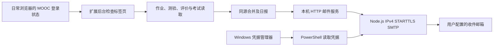

# 开发说明

浏览器扩展负责读取课程页面、生成报告并安排北京时间 20:00 的每日检查。Node.js 本机服务负责接收报告、保留回执并调用 PowerShell 发送邮件。

## 主要模块

- `extension/service_worker.js`：调度、分页课程发现、检查流程、邮件发送与重试。
- `extension/content.js`：读取 DOM、查看作业阶段和已存在的评价列表。
- `extension/exams.js`：只读解析考试列表，识别旧版空提示和新版考试记录。
- `extension/reviews.js`：评价阶段验证、数字最高分选择、评分表单校验和提交结果确认。
- `extension/model.js`：北京时间日期、完成状态、同源合并、临期筛选及报告文本。
- `extension/presentation.js` 与 `popup.*`：任务清单、筛选、截止倒计时、课程链接和报告复制。
- `bridge/server.js`：本机接口、连接令牌校验、报告保存及发送回执。
- `bridge/mailer.js` 与 `scripts/send-report.ps1`：邮件发送边界。
- `bridge/smtp.js`：IPv4 SMTP、STARTTLS 及证书验证；`smtp-cli.js` 从标准输入读取发信参数，避免授权码进入命令行或临时文件。
- `bridge/CredentialStore.cs`：Windows 普通凭据读写封装。

## 数据与接口

本机服务固定监听 `127.0.0.1:8765`。`GET /health` 返回版本和存活状态；`POST /hello`、`GET /status`、`POST /report` 需要 `X-MOOC-Token`。同一安装的令牌由 setup 生成，放在 Git 忽略的文件中。

报告使用新的 ID；同一 ID 已有发信回执时不重复发送。成功响应表示 SMTP 发送程序已成功返回，不能保证邮箱最终投递。发送结果不确定的网络故障可能造成重试，因此这不是端到端的“恰好一次”投递保证。

页面读取失败会产生 warning 或待核实项目。考试检查独立于测验读取；测验页失败或菜单尚未显示时，仍尝试考试列表。登录状态失效会停止本次检查，并生成需要登录的报告。

自评、互评分别记录完成证据。提交或自评的状态标记缺失时，不把它当作“未完成”；互评仍需完成标记、明确文字或评阅配额证据。不同任务编号即使标题、截止时间相同，也分别保留。

扩展在扫描开始时捕获定时日期，在发信前保存 `pendingMail` 与 `pendingMailSlot`。邮件重试沿用同一个报告编号，和手动检查共用并发保护。恢复时若已保留当日日报，则重发该报告；分钟级恢复闹钟只核对本地状态，有遗漏时才启动课程检查。新后台启动时核对并补建丢失的闹钟，不推迟现有定时。

## 修改时的约束

1. 作业答卷和考试仅做读取。自动评分仅在用户开启后适用于作业自评、互评，表单类型和数字评分项必须先识别。
2. 完成状态依赖可观察证据，缺少证据应保持未知。
3. 同源合并必须有源课程编号或任务编号依据，不能只按相似课程名合并。
4. 所有示例和测试使用虚构数据；报告、真实页面快照和个人配置留在 `.local`。
5. 变更页面读取逻辑时，添加会暴露该问题的测试，并在授权的测试账号或脱敏页面中验证。

`autoReviewEnabled` 仅存于扩展本机存储，默认关闭。评分分为 prepare 与 submit 两步：prepare 打开待评表单，逐项选择数字最高分并生成表单签名；后台保存 `autoReviewJournal` 的 submitting 记录后，submit 复核签名及选项并点击提交，等待网站成功提示。只有明确成功才记 confirmed；中断或结果不明时保留 submitting 状态，后续检查暂停该作业的该评价阶段。每次提交后重读作业概览；已完成状态优先于可选的“继续互评”入口。

## 权限

扩展申请 `alarms`、`notifications`、`storage`、`tabs`，主机权限限制为中国大学 MOOC 页面和本机 8765 端口。它用自己的后台标签页检查，沿用浏览器会话，报告保存在扩展本地存储和本机服务目录。

配置和原始报告可能包含学习信息。连接令牌只验证本机扩展与邮件服务，不应作为防御同一 Windows 用户下恶意程序的隔离边界。
